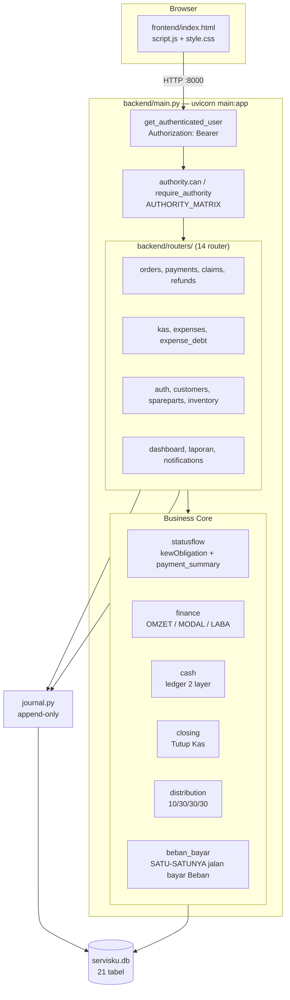
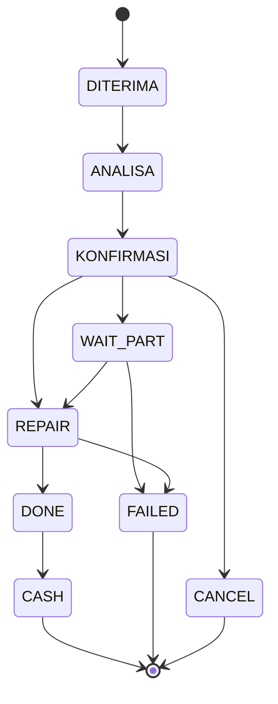
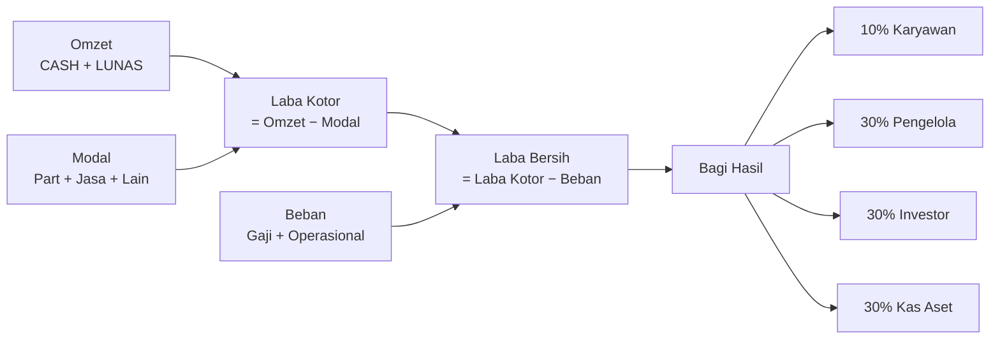

# BOSS SF — Business Operation Smart System

Sistem operasi untuk bengkel servis HP: penerimaan unit, alur servis, pencatatan
uang (DP, pelunasan, modal, beban), tutup kas, dan bagi hasil.

Dokumen ini adalah **referensi induk**. Untuk detail, lihat
[Dokumentasi Detail](#dokumentasi-detail).

---

## Konsep Inti

BOSS SF dibangun di atas satu pemisahan yang rarely benar di sistem bengkel
kecil: **unit yang diterima ≠ uang yang masuk ≠ beban yang harus dibayar.**
Setiap lapisan itu dicatat terpisah dan tidak boleh dicampur.

```
Unit diterima  →  status servis (9 status)     →  Timeline kerja
Pelunasan      →  Payment Ledger (DP/PELUNASAN) →  Kewajiban customer
Pengeluaran    →  Modal Part / Jasa / Lain      →  Laba Kotor
Beban          →  Gaji + Operasional             →  Laba Bersih
Tutup Kas      →  bagi hasil 10/30/30/30         →  Kas Aset
```

Hanya **tiga hal** boleh menyeber antar periode kas:
**Uang DP yang belum lunas**, **Hutang Beban**, dan **Kas Aset**.
Omzet, Modal, dan Beban bersifat eksklusif per periodenya.

Aturan bisnis lengkap dan status hukumnya ada di
[`docs/OWNER_DECISIONS.md`](docs/OWNER_DECISIONS.md) — itu dokumen kanonik,
README ini tidak mengulanginya.

---

## Fitur Utama

| Area | Cakupan |
|---|---|
| **Unit & Servis** | Terima unit (TITIP / PERBAIKAN / SPAREPART / TUNGGU), 9 status servis, penugasan teknisi, handover, pembatalan, kegagalan |
| **Transaksi** | DP & pelunasan, pelacakan kewajiban, refund DP / garansi / failed-cancel |
| **Keuangan** | Omzet, Modal 3 komponen, Laba Kotor, Beban, Laba Bersih |
| **Kas** | Ledger 2 layer (Laci / Kas Aset), periode kas, Tutup Kas, Declare/rekonsiliasi |
| **Bagi Hasil** | 10% Karyawan / 30% Pengelola / 30% Investor / 30% Kas Aset |
| **Garansi** | Klaimgaransi, resolusi (REPAIR / REPLACE / REFUND) |
| **Sparepart** | Stok, mutasi masuk/pakai, harga beli/jual |
| **Administrasi** | 7 role, kelola akun (nonaktifkan, bukan hapus), audit journal |

---

## Pengguna yang Dituju

| Peran | Kegunaan utama |
|---|---|
| **Super Admin** | Developer aplikasi. Kelola role, permission, konfigurasi, audit. |
| **Admin** | Manager toko. Operasional harian + Tutup Kas. |
| **Pengelola** | Pemilik. Read-only: melihat & mengunduh laporan. |
| **Investor** | Read-only: laporan dana. |
| **Kasir** | Terima unit, input DP/pelunasan,input kas. |
| **Teknisi** | Update progres servis, handover. |
| **Admin Sparepart** | Kelola sparepart. Tidak boleh hapus. |

Rincian lengkap: [`docs/PERMISSION_MATRIX.md`](docs/PERMISSION_MATRIX.md).

---

## Stack Teknologi

| Komponen | Teknologi | Versi |
|---|---|---|
| Backend | Python, FastAPI | 3.9 / fastapi 0.128.8 |
| Server | Uvicorn | 0.39.0 (`--reload` di mode dev) |
| ORM | SQLAlchemy | 2.0.52 |
| Database | **SQLite** (default) / PostgreSQL (opsional) | — |
| Auth | PBKDF2-HMAC-SHA256 + token opaque | 200.000 iterasi |
| Frontend | HTML + CSS + JS vanilla | — |
| Test | pytest | — |

Frontend **tanpa framework dan tanpa build step**. `index.html` dimuat langsung,
`script.js` dimuat apa adanya. Tidak ada npm, tidak ada bundler.

Rincian: [`docs/ARCHITECTURE.md`](docs/ARCHITECTURE.md).

---

## Arsitektur



**Aturan arsitektur yang tidak boleh dilanggar:**

- `backend/finance.py` adalah **satu-satunya** tempat Omzet / Modal / Laba dihitung.
  Pembaca lain **membaca**, tidak menghitung ulang.
- `backend/beban_bayar.py` adalah **satu-satunya** jalur pembayaran Beban.
  Jalur kedua dengan penanda idempotensi berbeda = Beban dibayar dua kali.
- `backend/statusflow.py` adalah satu-satunya sumber `kewajiban()` dan
  `payment_summary()`. Jangan karang ulang.
- `backend/authority.py` adalah satu-satunya sumber kebenaran wewenang.

---

## Struktur Repository

```text
.
├── backend/                  # FastAPI + SQLAlchemy
│   ├── main.py               # ENTRY POINT (app object)
│   ├── models.py             # 21 model / tabel
│   ├── database.py           # koneksi, DB_PATH
│   ├── authority.py          # MATRIKS WEWENANG  ← sumber kebenaran
│   ├── schemas.py            # validasi input
│   ├── statusflow.py         # kewajiban, payment_summary, transisi status
│   ├── finance.py            # CORE: omzet, modal, laba
│   ├── cash.py               # ledger kas 2 layer
│   ├── closing.py            # Tutup Kas
│   ├── distribution.py       # bagi hasil 10/30/30/30
│   ├── beban_bayar.py        # satu-satunya bayar Beban
│   ├── expense_debt.py       # Hutang Beban manual
│   ├── refunds.py            # 3 jenis refund
│   ├── journal.py            # append-only audit
│   ├── notifications.py      # outbox (TIDAK mengirim)
│   ├── idempotency.py        # Idempotency-Key
│   ├── inventory.py          # mutasi stok
│   ├── money.py              # helper desimal uang
│   ├── seed.py               # aman: tidak membuat akun default
│   ├── bootstrap_superadmin.py
│   ├── migrations_*.py       # migrasi kustom (tanpa Alembic)
│   ├── migrate_sqlite_to_postgres.py
│   └── routers/              # 14 router
├── frontend/                 # HTML/CSS/JS vanilla, tanpa build
├── tests/                    # pytest (lihat "Hasil Test" untuk jumlah terkini)
├── tools/                    # skrip operasional
├── docs/                     # dokumentasi detail
├── servisku.db               # DATABASE PRODUKSI (SQLite)
├── jalankan.bat              # mode dev
├── jalankan-online.bat       # mode publik (Cloudflare Tunnel)
├── setup-online.bat          # setup tunnel
├── matikan.bat               # stop
└── deploy-ubuntu.ps1         # deploy ke server Ubuntu
```

> **`app.py` di root bukan bagian dari BOSS SF.** Itu proyek Flask terpisah
> (port 5000, DB `keuangan_praktek.db`) yang tidak dijalankan apa pun.
> Lihat [`docs/AUDIT_FINDINGS.md`](docs/AUDIT_FINDINGS.md).

---

## Role dan Kewenangan Ringkas

7 role kanonik + 1 fallback `CUSTOM`.

| Role | Can mengubah | Boleh baca laporan |
|---|---|---|
| SUPERADMIN | Semua | Ya |
| ADMIN | Semua operasional + Tutup Kas | Ya |
| KASIR | Unit, bayar, kas masuk, refund DP | — |
| TEKNISI | Progres servis, handover | — |
| ADMIN SPAREPART | Sparepart (tulis) | Laporan sparepart |
| PENGELOLA | **Tidak boleh apa pun** | Laporan lengkap |
| INVESTOR | **Tidak boleh apa pun** | Laporan dana |

`PENGELOLA`/`PEMILIK` dan `INVESTOR` adalah **read-only blanketsatu**:
`can()` menolak mereka di semua aksi kecuali `REPORT_FULL` dan
`REPORT_INVESTOR`, apa pun isi matriks.

Alias resmi: `DEV`, `DEVELOPER`, `SUPER_ADMIN`, `SUPER ADMIN` → `SUPERADMIN`;
`PEMILIK` → `PENGELOLA`; `CS` → `KASIR`.

**`SUPERADMIN` bukan alias `ADMIN`.** Keduanya role terpisah
([OD-LOCK-10.1](docs/OWNER_DECISIONS.md)).

Matriks lengkap 28 aksi: [`docs/PERMISSION_MATRIX.md`](docs/PERMISSION_MATRIX.md).

---

## Lifecycle Servis

9 status kanonis:



Tiga dimensi status yang **terpisah**:

| Dimensi | Sumber | Nilai |
|---|---|---|
| Status Servis | Kolom `service_orders.status` | 9 status di atas |
| Status Bayar | **Diturunkan**, tidak disimpan | `LUNAS` / `BELUM LUNAS` |
| Status Unit | `unit_status` + `taken_at` | `DI TOKO` / `DIAMBIL` |

`CASH` bersifat **FINAL** — dikunci di `statusflow.check_transition()`.

Detail: [`docs/SERVICE_LIFECYCLE.md`](docs/SERVICE_LIFECYCLE.md).

---

## Alur Keuangan



- **Omzet** hanya dari unit `CASH` **dan** `LUNAS`. DP bukan Omzet.
- **Modal** tiga komponen terpisah, tidak boleh dihitung dua kali.
- **Beban** hanya Gaji + Operasional, beku sekali per periode.
- Kas `MANUAL` **tidak masuk** Omzet, Modal, Beban, atau Laba mana pun.

Detail: [`docs/FINANCE_FLOW.md`](docs/FINANCE_FLOW.md).

---

## Kas dan Tutup Kas

Posisi kas = **Saldo Laci + Saldo Aset** (2 layer). Saldo tiap layer =
saldo awal + seluruh mutasi layer tersebut.

Urutan Tutup Kas:

1. Hitung core keuangan periode.
2. **Catat modal terlewat** — order dalam kohort yang modalnya belum lengkap.
3. **Bayar sisa Beban** periode ini (`Laci` saja; Kas Aset tidak pernah
   tersentuh otomatis).
4. **Pastikan distribusi** terbentuk.
5. **Pindahkan 30% Hak Kas Aset** dari Laci → Kas Aset.
6. **Declare / rekonsiliasi** angka fisik laci → entri `REKONSILIASI`.
7. Simpan snapshot, tutup periode, **buka periode baru**.

Defisit **tidak** membentuk Hutang Beban secara otomatis. Tutup Kas hanya
menawarkan angka `kondisi_kas_akhir`; Hutang Beban diinput manual oleh Admin
([OD-LOCK-12](docs/OWNER_DECISIONS.md)).

---

## Database

| Item | Nilai |
|---|---|
| Default | SQLite, file `servisku.db` di root project |
| Override | env `DATABASE_URL` → PostgreSQL (`psycopg[binary]`) |
| Tabel | 21 |
| Migrasi | **Tanpa Alembic** — script kustom di `on_startup`, semua idempotent |
| Backup | Otomatis tiap start backend, prune 10 terbaru |
| Journal | `journal_entries` append-only, tanpa FK ke tabel domain |

`models.py` = 21 model = 21 tabel nyata di DB produksi. Sinkron.

Rincian tabel & relasi: [`docs/DATABASE.md`](docs/DATABASE.md).

---

## API

Semua endpoint di bawah `/api` kecuali yang ditandai. Autentikasi:
`Authorization: Bearer <token>`; token Dari `POST /api/auth/login`, TTL 7 hari.

Endpoint publik (tanpa auth): `POST /api/auth/login`, `GET /api/health`,
`GET /`, `GET /static/*`.

Daftar endpoint + penjaga role: [`docs/API_REFERENCE.md`](docs/API_REFERENCE.md).

---

## Instalasi & Menjalankan

**Prasyarat:** Python 3.9+, Git.

```powershell
# 1. Dependency
python -m pip install -r backend\requirements.txt

# 2. Jalankan (mode dev, reload aktif, 0.0.0.0:8000)
.\jalankan.bat
```

`jalankan.bat` menjalankan `python seed.py` lebih dulu — aman, script itu
**tidak** membuat akun default kecuali env `SUKABUMI_DEMO_SEED=1` aktif.

Manual (tanpa .bat):

```powershell
cd backend
python -m uvicorn main:app --host 0.0.0.0 --port 8000 --reload
```

Buka `http://localhost:8000`.

### Environment variable

Tidak ada file `.env`. Konfigurasi lewat environment variable OS:

| Variabel | Fungsi | Default |
|---|---|---|
| `DATABASE_URL` | Ganti SQLite → PostgreSQL | `sqlite:///servisku.db` |
| `NOTIF_PROVIDER_ENABLED` | Aktifkan provider notifikasi | nonaktif |
| `NOTIF_PRIVATE_ID` | Tujuan notifikasi | — |
| `SUKABUMI_DEMO_SEED` | Isi data demo saat seed | `0` |

> ⚠️ **Tidak ada akun default.** Akun Super Admin pertama dibuat lewat
> `backend/bootstrap_superadmin.py`. Lihat [`docs/DEPLOYMENT.md`](docs/DEPLOYMENT.md).

---

## Test

```powershell
python -m pytest tests -q
```

Hasil terakhir: **420 passed** (`python 3.9.13`). Angka ini naik setiap ada test
baru — yang wajib dijaga adalah **tidak ada failure**, bukan jumlah pastinya.

Test berjalan terhadap **salinan** `servisku.db` di direktori temp — DB
produksi tidak pernah dibuka untuk tulis oleh test.

Cek cepat lain:

```powershell
python -m compileall -q backend     # kompilasi Python
node --check frontend\script.js    # sintaks JS (perlu Node.js)
git status --short
```

Rincian coverage & bagian yang belum ada testnya:
[`docs/TESTING.md`](docs/TESTING.md).

---

## Deployment

Mekanisme yang benar-benar tersedia:

| Metode | Untuk |
|---|---|
| `deploy-ubuntu.ps1` | Deploy ke server Ubuntu via `tar`+`scp`+`ssh`, lalu `systemctl --user restart` |
| `jalankan-online.bat` | Mode lokal publik lewat Cloudflare Tunnel |
| `setup-online.bat` | Setup tunnel (sekali) |

**Tidak ada CI/CD. Tidak ada Docker.** Deploy adalah manual.

⚠️ Deploy **tidak** mengirim `servisku.db` kecuali dipanggil dengan
`-WithDb`. Detail & catatan keamanan: [`docs/DEPLOYMENT.md`](docs/DEPLOYMENT.md).

---

## Status Fitur

| Fitur | Status |
|---|---|
| Alur servis, DP, pelunasan, refund | ✅ Aktif |
| Core keuangan (omzet/modal/laba) | ✅ Aktif |
| Kas 2 layer, Tutup Kas, Declare | ✅ Aktif |
| Bagi hasil + 30% Hak Kas Aset | ✅ Aktif |
| Beban beku per periode, bayar dari Laci | ✅ Aktif |
| Garansi & klaim | ✅ Aktif (resolusi REFUND **tidak** mengirim uang otomatis) |
| Sparepart & stok | ✅ Aktif |
| Permission 7 role | ✅ Aktif (matriks tunggal) |
| Notifikasi | ⚠️ **Outbox saja** — tidak ada pengiriman ke Telegram/WA |
| Audit log UI | ⚠️ Action `AUDIT_READ` ada, **belum ada** endpoint atau halaman audit |
| Konfigurasi permission UI | ⚠️ `ROLE_CONFIG` ada di matriks, belum dipakai endpoint mana pun |
| Rate limiting login | ❌ Tidak ada |
| CI/CD, Docker | ❌ Tidak ada |

Rincian temuan: [`docs/AUDIT_FINDINGS.md`](docs/AUDIT_FINDINGS.md).

---

## Batasan yang Diketahui

1. **Tidak ada rate limiting di login.** Passcode ≥4 karakter bisa ditebak
   tanpa batas.
2. **`GET /api/health` publik** membocorkan versi aplikasi.
3. **CORS `allow_origins=["*"]`**.
4. **Idempotency tidak konsisten.** 5 dari 6 endpoint yang memakainya melakukan
   `commit()` di dalam aksi, sehingga record `IN_PROGRESS` tidak pernah
   selesai — retry dengan key sama menghasilkan 409, bukan replay.
5. **`POST /api/orders` tidak memvalidasi matriks transisi**, berbeda dengan
   `POST /api/orders/receive`.
6. **Migration ke PostgreSQL tidak bisa dijalankan** — daftar tabel di
   `migrate_sqlite_to_postgres.py` hanya 11 dari 21.
7. `tools/run_tunnel.bat` memakai path drive yang tidak ada.
8. Tidak ada akun `INVESTOR` maupun `ADMIN_SPAREPART` di DB produksi, jadi
   jalur wewenang mereka belum pernah dieksekusi di produksi.

---

## Dokumentasi Detail

| Dokumen | Isi |
|---|---|
| [`docs/OWNER_DECISIONS.md`](docs/OWNER_DECISIONS.md) | **KANONIK.** Sumber kebenaran aturan bisnis. Status OD-LOCK-01..12. |
| [`docs/BUSINESS_RULES.md`](docs/BUSINESS_RULES.md) | Ringkasan aturan bisnis + tautan ke kode yang menegakkannya |
| [`docs/PERMISSION_MATRIX.md`](docs/PERMISSION_MATRIX.md) | 28 aksi × 7 role, alias, anti-eskalasi |
| [`docs/SERVICE_LIFECYCLE.md`](docs/SERVICE_LIFECYCLE.md) | Status, transisi, garansi, refund |
| [`docs/FINANCE_FLOW.md`](docs/FINANCE_FLOW.md) | Rumus, periode kas, tutup kas, distribusi |
| [`docs/DATABASE.md`](docs/DATABASE.md) | 21 tabel, relasi, migrasi, backup |
| [`docs/API_REFERENCE.md`](docs/API_REFERENCE.md) | Endpoint + penjaga role |
| [`docs/ARCHITECTURE.md`](docs/ARCHITECTURE.md) | Struktur, alur request, titik kritis |
| [`docs/TESTING.md`](docs/TESTING.md) | Cara test, cakupan, celah |
| [`docs/DEPLOYMENT.md`](docs/DEPLOYMENT.md) | Cara jalankan, deploy, env, keamanan |
| [`docs/AUDIT_FINDINGS.md`](docs/AUDIT_FINDINGS.md) | Temuan audit, konflik, hal belum diputuskan |
| [`docs/legacy/`](docs/legacy/) | Dokumentasi lama (arsip, 2026-10-17) |

> Dokumen di `docs/legacy/` **tidak lagi jadi acuan**. Sebagian di antaranya bisa bertentangan
> this README. Arahkan perubahan ke dokumen kanonik di atas.

---

## Konvensi Pelaporan

Dokumen ini memakai penanda agar tidak menyamarkan asumsi sebagai fakta:

| Penanda | Arti |
|---|---|
| ✅ / `[FAKTA]` | Terverifikasi dari kode atau test |
| 🔒 `[TERKUNCI]` | Keputusan Owner, wajib dipatuhi |
| ⚠️ `[TEMUAN]` | Hasil audit; bisa jadi bug, bisa jadi disengaja |
| ❓ `[BELUM DIPUTUSKAN]` | Tidak ada keputusan Owner; jangan diasumsikan |

Kalau dokumentasi dan kode berbeda, **kode adalah fakta**, dan selisihnya
dicatat di [`docs/AUDIT_FINDINGS.md`](docs/AUDIT_FINDINGS.md) — bukan
diperbaiki sepihak.