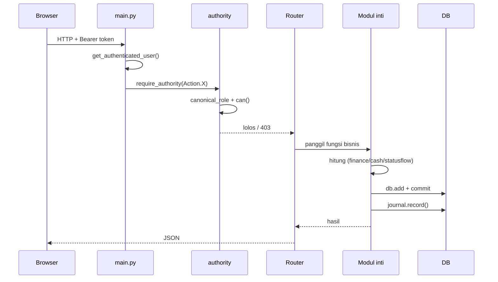

# ARCHITECTURE - BOSS SF

---

## 1. Bentuk umum

BOSS SF adalah **monolit modular**: satu proses FastAPI, satu database, satu
frontend statis tanpa build.

```
Browser (HTML + JS vanilla)
        |
        |  HTTP :8000
        v
FastAPI (backend/main.py)
  - routers/   : HTTP, validasi, orkestrasi tipis
  - modul inti : aturan bisnis (finance, cash, statusflow, closing, ...)
  - authority  : satu matriks wewenang
        |
        v
SQLite (servisku.db)  -- atau PostgreSQL lewat DATABASE_URL
```

Tidak ada message queue, tidak ada microservice, tidak ada worker terpisah.

---

## 2. Layer

```mermaid
flowchart TB
    subgraph L1["Presentation"]
        FE["frontend/<br/>index.html, script.js, style.css"]
    end
    subgraph L2["Transport — routers/ (14 router)"]
        HTTP["auth, orders, payments, kas, ..."]
    end
    subgraph L3["Domain — modul inti"]
        SF["statusflow.py<br/>kewajiban, status"]
        FN["finance.py<br/>omzet, modal, laba"]
        CA["cash.py<br/>ledger kas"]
        CL["closing.py<br/>tutup kas"]
        DI["distribution.py<br/>bagi hasil"]
        BB["beban_bayar.py<br/>bayar beban"]
    end
    subgraph L4["Cross-cutting"]
        AU["authority.py<br/>matriks wewenang"]
        JR["journal.py<br/>audit"]
        ID["idempotency.py"]
        NT["notifications.py<br/>outbox"]
    end
    subgraph L5["Data"]
        MD["models.py — 21 model"]
        DB[("servisku.db — 21 tabel")]
    end

    FE --> HTTP
    HTTP --> L3
    HTTP --> AU
    L3 --> JR
    HTTP --> ID
    L3 --> NT
    L3 --> L5
```



**Aturan layer:**

- Router **tidak** boleh menghitung Omzet/Modal/Laba sendiri.
- Modul inti **tidak** meng-import router.
- `authority.py` boleh meng-import `routers/auth.py` (untuk
  `get_authenticated_user`) — arah ini yang memicu circular import dan
 helper lokal `_matrix_user` di `routers/auth.py`.

---

## 3. Modul inti

| Modul | Tanggung jawab | Ukuran |
|---|---|---|
| `statusflow.py` | `kew()`, `payment_summary()`, transisi status, validasi DP | 14.7 KB |
| `finance.py` | `compute_finance_core()`, beku Beban, `period_key()` | 22.1 KB |
| `cash.py` | ledger 2 layer, mutasi, Declare, `dp_terpakai()` | 32.8 KB |
| `closing.py` | `tutup_periode()` | 19.2 KB |
| `distribution.py` | 10/30/30/30, topup, topdown, Hak Kas Aset | 31.7 KB |
| `beban_bayar.py` | satu-satunya jalur bayar Beban | 8.4 KB |
| `expense_debt.py` | Hutang Beban manual | 12.4 KB |
| `refunds.py` | 3 jenis refund | 11.9 KB |
| `inventory.py` | mutasi stok | 12.5 KB |
| `journal.py` | audit append-only | 4.3 KB |
| `authority.py` | matriks wewenang | 16.1 KB |
| `notifications.py` | outbox | 9.9 KB |
| `idempotency.py` | `Idempotency-Key` | 3.5 KB |

---

## 4. Router

| Prefix | Modul | Endpoint |
|---|---|---|
| `/api/auth` | `auth` | 8 |
| `/api/orders` | `orders` | 11 |
| `/api/payments` | `payments` | 2 |
| `/api/kas` | `kas` | 20 |
| `/api/expenses` | `expenses` | 4 |
| `/api/beban-hutang` | `expense_debt` | 6 |
| `/api/claims` | `claims` | 9 |
| `/api/refunds` | `refunds` | 7 |
| `/api/customers` | `customers` | 7 |
| `/api/spareparts` | `spareparts` | 4 |
| `/api/inventory` | `inventory` | 5 |
| `/api/notifications` | `notifications` | 2 |
| `/api/laporan`, `/api/overview`, `/api/period`, `/api/statistics` | `dashboard`, `laporan` | 7 |

Total **89 endpoint**.

⚠️ Prefix sparepart adalah `/api/spareparts` (dengan huruf **e**).

Daftar lengkap: [API_REFERENCE.md](API_REFERENCE.md).

---

## 5. Alur request



Semua penjaga role **wajib** lewat `require_authority(Action.X)`.

---

## 6. Dependency yang siklik

[FAKTA] Ada satu arah siklik yang sudah ditangani:

```
authority.py  --import-->  routers/auth.py  (get_authenticated_user)
routers/auth.py  --TIDAK bisa import-->  authority.py
```

Solusinya: helper `_matrix_user(action)` di `routers/auth.py` yang melakukan
`import authority` **di dalam fungsi**. Penegakannya tetap `authority.can()`.

[FAKTA] `require_admin` yang dulu ada di `auth.py` sudah **dihapus** karena
membypass matriks dan tidak mengenali alias. Audit ulang: sisa pemakaian = 0.

---

## 7. Startup

`backend/main.py` pada `@app.on_event("startup")`:

1. `_backup_database()`
2. `Base.metadata.create_all(bind=engine)`
3. `_migrate_schema()`
4. 5 migrasi modul (tiap-tiap dibungkus `try/except`)
5. `_migrate_status_data()` + `_migrate_checklist_subset()`
6. `seed.ensure_admin()` — hanya mengecek, tidak pernah membuat akun

[FAKTA] Kalau backup gagal, migrasi **data** dilewati; pembuatan tabel tetap.

---

## 8. Frontend

Tanpa framework, tanpa build step, tanpa bundler.

| File | Isi |
|---|---|
| `index.html` | 184.9 KB — seluruh halaman |
| `script.js` | 365.6 KB — logika, fetch API, render |
| `style.css` | 160.7 KB — styling |
| `assets/logo.png` | Logo |
| `assets/nota-ref.jpeg` | Contoh nota |

[FAKTA] Fungsi render penting di `script.js`:
`renderKondisiKas()`, `renderKuTitipan()`.

[FAKTA] `txdRefundDP` dan `txdFailedCancel` terdefinisi tapi tidak terpakai —
dead code yang **sengaja tidak dibersihkan**.

[TERKUNCI] UI harus **fail-closed**: kalau data tidak bisa diambil, jangan
tampilkan angka fallback yang terlihat seperti data asli.

[FAKTA] Halaman notifikasi adalah outbox — tidak ada pengiriman ke
Telegram/WA.

---

## 9. Batas-batas yang disengaja

| Batas | Alasan |
|---|---|
| Monolit, tanpa worker | Skala satu bengkel;antrean adds failure modes tanpa manfaat |
| Tanpa CI/CD | Deploy manual, repo kecil |
| Tanpa Docker | Deployment ke Windows + Ubuntu langsung |
| Tanpa Alembic | Migrasi kustom per-periode; Alembic belum perlu |
| Tanpa framework frontend | Tidak ada build; mudah di-deploy |
| `journal` tanpa FK | Supaya tidak bisa terhapus cascade |

[FAKTA] Kalau ``_prune_backups`` gagal, hanya log — backup tidak boleh membuat
start aplikasi gagal.

---

## 10. Titik kritis saat mengubah kode

| Kalau mengubah | Wajib menjaga |
|---|---|
| `finance.py` | Satu-satunya sumber Omzet/Modal/Laba. Jangan duplikasi. |
| `beban_bayar.py` | Penanda idempotensi `beban_periode` tunggal. |
| `closing.py` | Urutan Tutup Kas sesuai [FR-02](OWNER_DECISIONS.md). |
| `statusflow.py` | `CASH` harus tetap final. |
| `authority.py` | Jangan tambah daftar role terpisah. |
| `routers/auth.py` | Anti-eskalasi + journal akun wajib tetap. |
| `models.py` | Tambah kolom wajib disertai script migrasi idempotent. |
| `script.js` | Fail-closed. Jangan tampilkan angka fallback. |

Detail aturan: [AGENTS.md](../AGENTS.md).