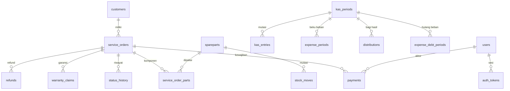

# DATABASE - BOSS SF

[`backend/models.py`](../backend/models.py) mendefinisikan **21 model** = **21
tabel**. Keduanya sinkron di DB produksi (diverifikasi 2026-10-17).

---

## 1. Koneksi

[`backend/database.py`](../backend/database.py):

```python
DB_PATH = <root project>/servisku.db
SQLALCHEMY_DATABASE_URL = os.environ.get("DATABASE_URL") or f"sqlite:///{DB_PATH}"
```

| Item | Nilai |
|---|---|
| Default | SQLite di `servisku.db` (root project) |
| Override | env `DATABASE_URL` untuk PostgreSQL |
| SQLite | `check_same_thread=False`, tanpa WAL |
| PostgreSQL | `pool_pre_ping`, `pool_size=10`, `max_overflow=20` |

Driver: `psycopg[binary]`.

**DB produksi lokal = `servisku.db` di root.** Test memakai salinan di temp
(`tests/conftest.py`) dan tidak pernah menulis ke DB produksi.

---

## 2. Tabel

Jumlah baris per 2026-10-17.

| Tabel | Baris | Isi |
|---|---|---|
| `service_orders` | 8 | Unit servis |
| `customers` | 7 | Data customer |
| `payments` | 9 | **Ledger pembayaran** (sumber resmi) |
| `status_history` | 22 | Riwayat perubahan status |
| `spareparts` | 0 | Stok sparepart |
| `service_order_parts` | 0 | Komponen per order |
| `stock_moves` | 0 | Mutasi stok |
| `warranty_claims` | 0 | Klaim garansi |
| `refunds` | 0 | Refund |
| `expenses` | 6 | Master Beban |
| `expense_periods` | 12 | **Beku Beban per periode** |
| `expense_debt_periods` | 0 | Hutang Beban per periode |
| `expense_debt_entries` | 0 | Rincian Hutang Beban |
| `kas_entries` | 36 | **Ledger kas** |
| `kas_periods` | 3 | Periode kas (2 CLOSED, 1 OPEN) |
| `distributions` | 2 | Bagi hasil |
| `journal_entries` | 79 | **Audit append-only** |
| `notifications` | 22 | Outbox (semua `DIANTREKAN`) |
| `users` | 6 | Akun |
| `auth_tokens` | 1 | Sesi aktif |
| `idempotency_keys` | 2 | Idempotency-Key |

### Yang tidak ada

Tidak ada tabel `audit_log` terpisah - audit memakai `journal_entries`.

Tidak ada akun `INVESTOR` maupun `ADMIN_SPAREPART` di produksi.

---

## 3. Relasi inti



### Relasi yang sengaja tidak dibuat

[FAKTA] `journal_entries` **tidak** punya ForeignKey ke tabel domain. Tujuannya
agar journal tidak bisa terhapus cascade. Konsekuensi: query journal harus
menyertakan `entity_type` + `entity_id` secara manual.

---

## 4. Kolom yangozonan (money)

[TERKUNCI] Semua kolom uang bertipe **fixed-point**, bukan float.

Cara: `backend/money.py` + migrasi `migrations_money.py` membulatkan **14 kolom
uang** di 7 tabel ke 2 desimal pada setiap start aplikasi.

SQLite: `ROUND(x, 2)`. PostgreSQL: `ALTER COLUMN ... TYPE NUMERIC(18,2)`.

Jangan pernah memakai `float` untuk uang.

---

## 5. Kolom legacy

[FAKTA] `service_orders.payment` menyimpan total DP versi lama untuk **arsip UI**.
DP juga tercatat di `payments` (ledger).

`statusflow.payment_summary()` mengurangi bagian legacy yang sudah ada di
jurnal, supaya tidak dobel hitung.

[FAKTA] Kolom `cash_date` / `cash_at` sudah di-rename jadi `lunas_date` /
`lunas_at` saat migrasi startup.

**Implikasi untuk query:** jangan menjumlahkan `service_orders.payment` sebagai
angka resmi. Angka resmi dari ledger `payments`.

---

## 6. Migrasi

[FAKTA] **Tidak ada Alembic.**

Mekanisme: script kustom + `Base.metadata.create_all`, semuanya jalan di
`@app.on_event("startup")` pada `backend/main.py`.

Urutan boot:

1. `_backup_database()`
2. `Base.metadata.create_all(bind=engine)`
3. `_migrate_schema()` - inline di `main.py`
4. 5 migrasi modul, masing-masing dibungkus `try/except`
5. `_migrate_status_data()` + `_migrate_checklist_subset()`
6. `seed.ensure_admin()` - hanya mengecek, tidak pernah membuat akun

Kalau backup gagal, migrasi **data** dilewati; pembuatan tabel tetap jalan.

### Daftar migrasi

| File | Yang dilakukan | Idempotent |
|---|---|---|
| `migrations_money.py` | Bulatkan 14 kolom uang | Ya |
| `migrations_warranty_claims.py` | Tambah `resolusi`, `origin_payment_status`, `origin_warranty_months` | Ya |
| `migrations_cash_layers.py` | Tambah 6 kolom `kas_entries` + backfill `layer='LACI'` + index | Ya |
| `migrations_expense_recurring.py` | Tambah `expenses.recurring` | Ya |
| `migrations_tanpa_modal.py` | Tambah `service_orders.tanpa_modal` | Ya |
| `main.py:_migrate_schema` | 15 `ADD COLUMN` + rename `cash_*` ke `lunas_*` + backfill | Ya |
| `main.py:_migrate_status_data` | Mapping status legacy + backfill Payment | Ya |

[FAKTA] Semua migrasi wajib idempotent dan dibungkus `try/except` supaya
kegagalan tidak mematikan start aplikasi.

### Menambah kolom baru

`create_all` **tidak** meng-update tabel yang sudah ada. Wajib buat script
migrasi idempotent.

---

## 7. Migrasi ke PostgreSQL

`backend/migrate_sqlite_to_postgres.py` - script **sekali pakai**, bukan
versi migrasi.

[FAKTA] **Script ini tidak bisa dijalankan sekarang.** `TABLE_ORDER` hanya
mencakup 11 tabel, sedangkan ada 21. Guard akan `sys.exit` sebelum transfer.

Tabel yang tidak terdaftar: `journal_entries`, `expense_periods`,
`distributions`, `refunds`, `expense_debt_periods`, `expense_debt_entries`,
`stock_moves`, `service_order_parts`, `notifications`, `idempotency_keys`.

Lihat [AUDIT_FINDINGS.md](AUDIT_FINDINGS.md).

---

## 8. Backup

[TERKUNCI] Backup otomatis **setiap start backend**, sebelum migrasi apa pun.

| Item | Nilai |
|---|---|
| SQLite | `shutil.copy2` -> `backup-servisku-<YYYYmmdd-HHMMSS>.db` |
| PostgreSQL | `pg_dump` via subprocess |
| Prune | `keep=10`, hanya pola `backup-servisku-*` |
| Letak | folder yang sama dengan DB |

[FAKTA] Backup dengan pola lain (`backup-pre*`, `checkpoint-*`, `archive-*`)
**tidak pernah di-prune**. Ada 20 file `.db` di root, sebagian sudah usang.

Kegagalan backup -> `_backup_ok = False` -> migrasi data dilewati.

Test: `tests/test_backup_prune.py`.

---

## 9. Idempotency

Tabel `idempotency_keys`, header `Idempotency-Key`, fungsi
`idempotency.jalankan()`.

Tiga hasil:

| Kondisi | Hasil |
|---|---|
| Key baru | Jalankan aksi, simpan response |
| Key ada, hash sama, `COMPLETED` | **Replay** - kembalikan response tersimpan |
| Key ada, hash berbeda | **409** `KEY_REUSE` |
| Key ada, status `IN_PROGRESS` | **409** `IN_PROGRESS` |

[FAKTA] Fungsi ini tidak melakukan `commit()`. Commit di caller.

Endpoint pemakai: payments, kas transfer, kas close, refunds, inventory,
expense_debt.

[FAKTA] **Bug:** 5 dari 6 pemanggil melakukan `commit()` **di dalam** aksi,
sehingga record `IN_PROGRESS` ikut ter-commit dan update ke `COMPLETED`
hilang saat session ditutup. Bukti: `idempotency_keys` produksi berisi 2 baris
`IN_PROGRESS` untuk `scope='kas.close'` padahal periodenya berhasil ditutup.
Konsekuensi: retry dengan key sama selalu 409, bukan replay.

Yang benar: `payments.py` - commit dilakukan setelah `jalankan` selesai.

---

## 10. Journal

Tabel `journal_entries`, append-only.

| Kolom | Isi |
|---|---|
| `ts` | Waktu |
| `domain` | SERVICE, PAYMENT, KAS, FINANCE, INVENTORY, WARRANTY, SYSTEM |
| `event` | Nama event |
| `entity_type`, `entity_id` | Objek yangjfik berubah |
| `ref_type`, `ref_code` | Referensi |
| `amount` | Nominal (Decimal) |
| `actor`, `source` | Aktor |
| `details` | JSON |

[FAKTA] Tidak ada `update_journal()` atau `delete_journal()`. Tidak ada FK ke
tabel domain. `record()` tidak pernah `commit()` - ikut transaksi pemanggil.

[FAKTA] Perubahan akun (nama/role/status/passcode) **wajib** masuk journal
lewat `_catat_jurnal_akun()` lengkap nilai sebelum & sesudah. Passcode tidak
pernah masuk journal.

---

## 11. Verify sendiri

```powershell
python -c "import sqlite3;d=sqlite3.connect(r'servisku.db');print(d.execute('select count(*) from sqlite_master where type=''table''').fetchone())"
python -m pytest tests\test_migration_idempotent.py tests\test_backup_prune.py `
  tests\test_money_ledger.py tests\test_migration_idempotent.py -q
```
