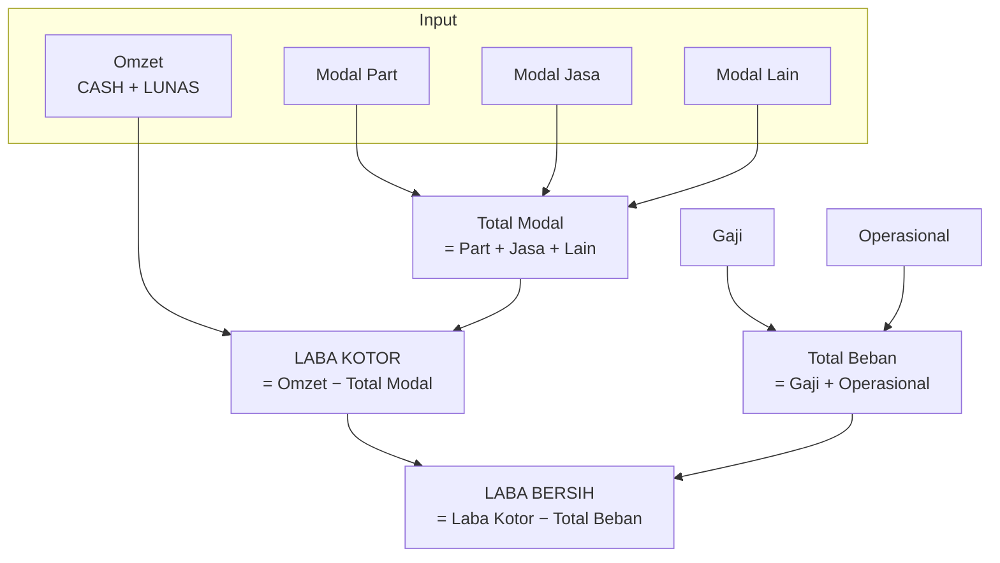

# FINANCE FLOW — BOSS SF

[`backend/finance.py`](../backend/finance.py) adalah **satu-satunya** tempat
Omzet, Modal, dan Laba dihitung. Dokumen ini menjelaskan alurnya — tidak
menggantikan kode.

Aturan bisnis kanonik: [OWNER_DECISIONS.md](OWNER_DECISIONS.md)
([FR-01](OWNER_DECISIONS.md), [OD-LOCK-11](OWNER_DECISIONS.md),
[OD-LOCK-12](OWNER_DECISIONS.md)).

---

## 1. Empat angka utama



Semua dihitung di `finance.compute_finance_core()`.

---

## 2. Kapan unit masuk Omzet

Empat syarat **semua wajib** (`finance.settled_orders()`):

| # | Syarat | Sumber |
|---|---|---|
| 1 | `status == "CASH"` | `service_orders.status` |
| 2 | Modal terisi (`>0`) **atau** `tanpa_modal = True` | `service_orders` |
| 3 | `payment_status == "LUNAS"` | **dari ledger `payments`** |
| 4 | `cash_moment()` berada di dalam `[start, end)` | lihat §3 |

🔒 DP **bukan** Omzet. Unit yang sudah `CASH` tapi belum lunas tidak masuk
Omzet.

**Sumber angka resmi = ledger `payments`.** Ada kolom legacy
`service_orders.payment` yang sengaja disimpan sebagai arsip UI. Query mentah
yang menjumlahkan keduanya akan salah. `statusflow.payment_summary()`
mengurangi bagian legacy yang sudah ada di jurnal.

### Gerbang modal

`modal_sudah_diisi()`akibat> 0`. Kalau `tanpa_modal=True`, wajib konsisten:
mengisi modal dan menandai `tanpa_modal` bersamaan → **400**.

---

## 3. `cash_moment()` — waktu yang dipakai

Urutan fallback (`statusflow.py`):

```
taken_at  →  lunas_at  →  lunas_date (pukul 12:00)
          →  service_date (pukul 12:00)  →  created_at
```

Unit yang di-CASH lalu di-bayar ulang akan bergeser ke `lunas_at`. Ini
memengaruhi periode mana yang menanggungnya.

---

## 4. Modal — tiga komponen terpisah

| Kolom | Nama |
|---|---|
| `part_cost` | Modal Part |
| `modal_jasa` | Modal Jasa |
| `modal_lainnya` | Modal Lain |

[TERKUNCI] Tiga komponen **tidak boleh digabung** — tiap komponen punya
`ref_type` sendiri di ledger kas (`MODAL_PART`, `MODAL_JASA`, `MODAL_LAIN`)
sehingga idempoten per komponen.

Modal diisi pada event `CASH`; `modal=None` dinormalkan jadi `0` saat `DONE`.
🔒 Hanya SUPER + ADMIN boleh mengisi modal (`ORDER_UPDATE_MODAL`).

Metode hitung Modal Jasa (manual / 40% / 50%) ada di
[OD-LOCK-11 lanjutan](OWNER_DECISIONS.md).

---

## 5. Beban

🔒 Hanya **Gaji** dan **Operasional**. `BEBAN_KATEGORI = ("gaji","operasional")`.
Kategori lain **tidak dibekukan sama sekali**.

### Beku per periode

Sekali per periode — kunci memakai **`kas_periods.id`**, bukan tanggal.
Kalau baris beku untuk periode itu sudah ada, fungsi **tidak melakukan apa-apa**.

`recurring=True` (default) → dibekukan ke **setiap** periode.
`recurring=False` → hanya di periodenya.

### Kapan dibayar

Tiga pemicu, **satu mesin**, **satu penanda idempotensi**:

| Pemicu | Lokasi |
|---|---|
| Beku pertama dibuat | `finance.freeze_expenses_for_period()` |
| Setiap event `CASH` | dipanggil dari router order |
| Tutup Kas (sisa saja) | `closing.selesaikkan_periode()` |

Penanda tunggal: `ref_type="beban_periode"`, `ref_id=period_key`.

⚠️ **Jangan tambah jalur bayar Beban kedua dengan penanda berbeda** — itu
menyebabkan Beban dibayar dua kali. Semua lewat `beban_bayar.bayar_beban_periode()`.

### Dari mana dananya

- `dari_laci = min(sisa, saldo_laci)`
- `dari_aset` = **0 selalu** 🔒

Kas Aset tidak pernah tersentuh otomatis; hanya dilaporkan sebagai
`bisa_ditutup_manual`.

---

## 6. Transaksi kas `MANUAL`

Entri kas dengan `sumber="MANUAL"`.

| Pertanyaan | Jawaban |
|---|---|
| Masuk Omzet? | **Tidak** |
| Masuk Modal? | **Tidak** |
| Masuk Beban? | **Tidak** |
| Masuk Laba? | **Tidak** — hanya dijumlahkan sebagai `tambahan_kas` (informasi) |
| Masuk Buku Kas? | **Ya** |
| Tampil di Mutasi Kas? | **Ya**, sebagai baris fisik |

Kategori `"Saldo Awal"` dikecualikan dari `tambahan_kas`.

---

## 7. Kas — model 2 layer

```
MASTER KAS = Saldo Laci + Saldo Aset
```

Layer: `LACI`, `KAS_ASET`.
Saldo per layer = `opening(kategori="Saldo Awal")` + seluruh mutasi layer itu.

### Sumber entri kas

| Sumber | Dipicu oleh | Arah |
|---|---|---|
| `PAYMENT` | setiap Payment (DP & pelunasan) | Masuk Laci |
| `MODAL` | event CASH, per komponen | Keluar Laci |
| `MODAL` (koreksi) | Tutup Kas | Masuk/Keluar = selisih |
| `BEBAN` | `beban_bayar` | Keluar Laci |
| `CASH_OUT` | distribusi 70% | Keluar Laci |
| `DISTRIBUSI_ASET` | 30% Hak Kas Aset saat Tutup Kas | Keluar Laci + Masuk Aset |
| `DISTRIBUSI_ASET` | top-down (laba turun) | Masuk Laci (koreksi) |
| `TRANSFER` | `POST /api/kas/aset/transfer` | pasangan Laci↔Aset |
| `INJEKSI` | `POST /api/kas/aset/masuk` | Masuk |
| `REKONSILIASI` | Declare saat Tutup Kas | = selisih fisik |
| `REFUND_DP`, `FAILED_CANCEL` | refund | Keluar Laci |
| `MANUAL` | entri kas bebas | bebas |

[FAKTA] `REFUND_GARANSI`, `PENYESUAIAN`, `HUTANG_BEBAN` **tidak pernah ditulis**
entri — konstantanya ada tapi tidak terpakai.

---

## 8. Periode kas

Periode = baris `KasPeriod` dengan status `OPEN`/`CLOSED`.

Batas efektif = **waktu dibuka sampai ditutup** — bukan tanggal. Selama OPEN,
batas akhirnya `datetime.max`.

Angka jam (16:00) hanya **patokan reminder**, bukan batas periode.

Periode aktif = OPEN terakhir.

🔒 Hanya **tiga** yang boleh menyeber antar periode:

| Yang menyeber | Ke mana |
|---|---|
| DP yang belum lunas | periode service-nya |
| Hutang Beban | periode pencatatannya |
| Kas Aset | saldo Laci |

Omzet, Modal, dan Beban **tidak boleh** disambungkan antar periode.

---

## 9. DP

🔒 Tiga aturan:

1. DP = **titipan customer**, bukan kas toko.
2. DP tidak boleh melebihi estimasi.
3. DP dianggap terpakai **sebesar kewajiban unit**, dan **hanya bila LUNAS**.

```python
dp_terpakai = 0                        # belum LUNAS
dp_terpakai = min(total_DP, kewajiban)     # sudah LUNAS
```

Kewajiban = `final_price ?? estimate`.

DP tetap menambah Saldo Laci (itu cara buku kas-nya benar); pemisahan "bukan
Omzet" dibuat di **penyajian** (`kas_aset_awal_operasional`), bukan dengan
menolak pencatatannya.

Penjaga estimasi ada di 4 jalur: terima unit, create order, update order, dan
input payment.

---

## 10. Tutup Kas

Otoritas: `KAS_CLOSE` → SUPER + ADMIN saja.
Eksekusi kedua pada periode sama → **409**.

Urutan:

1. Hitung core keuangan periode.
2. **Catat modal terlewat** untuk order dalam kohort.
3. **Bayar sisa Beban** (dari Laci saja).
4. **Pastikan distribusi** terbentuk.
5. **Pindahkan 30% Hak Kas Aset** Laci → Aset.
6. **Declare / rekonsiliasi** → entri `REKONSILIASI`.
7. Simpan snapshot JSON, **tutup** periode, **buka periode baru**.
8. Dua notifikasi outbox.

🔒 **Tidak boleh** memakai DP titipan untuk menutup defisit, dan **tidak boleh**
memaksa distribusi.

🔒 Defisit **tidak** membuat Hutang Beban otomatis
([OD-LOCK-12](OWNER_DECISIONS.md)). Tutup Kas hanya melaporkan
`kondisi_kas_akhir`; Hutang Beban diinput manual oleh Admin.

⚠️ Konsekuensi: endpoint catat hutang menolak periode yang bukan OPEN, sedangkan
Tutup Kas sudah menutup periode. Alur "catat hutang saat Tutup Kas" secara
harfiah tidak mungkin. Lihat [AUDIT_FINDINGS.md](AUDIT_FINDINGS.md).

---

## 11. Bagi hasil 10/30/30/30

```
10% Karyawan | 30% Pengelola | 30% Investor | 30% Kas Aset
```

Dasar = **Laba Bersih**.

**Syarat terbentuk** (all-or-nothing):
- CTO tercapai: `laba_kotor >= gaji + operasional`
- `laba_bersih > 0`
- Saldo Laci cukup untuk 100%

**Timing** 🔒 ([OD-LOCK-11.5](OWNER_DECISIONS.md)):

| Bagian | Kapan keluar |
|---|---|
| 70% (Karyawan + Pengelola + Investor) | Saat distribusi terbentuk |
| **30% Hak Kas Aset** | **Saat Tutup Kas** |

Sisa pembuluan masuk Hak Kas Aset.

**Top-up** = laba naik → tambah alokasi.
**Top-down** = laba turun → kurang alokasi; menolak bila 30% sudah dipindah.

---

## 12. Pembaca lain tidak boleh menghitung ulang

| Modul | Yang dilakukan |
|---|---|
| `routers/dashboard.py` | Membaca `core` apa adanya |
| `closing.py` | Memakai hasil hitungan dari router |
| `expense_debt.py` | Membaca core, tidak mengubah |

[FAKTA] Angka turunan di dashboard (`total_masuk`, `total_keluar`, `saldo`)
adalah **Buku Kas akrual** — bukan saldo Laci. Jangan dipakai sebagai
pengganti saldo kas.

---

## 13. Verify sendiri

```powershell
python -m pytest tests\test_finance_core.py tests\test_od_lock_06_beban.py `
  tests\test_periode_isolasi.py tests\test_hutang_laba_kotor.py `
  tests\test_cash_realisasi.py tests\test_distribusi_topup.py -q
```
