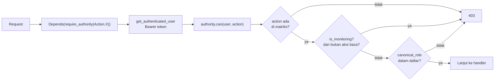

# PERMISSION MATRIX — BOSS SF

[`backend/authority.py`](../backend/authority.py) adalah **satu-satunya** sumber
kebenaran wewenang. Dokumen ini merangkum isinya — bukan menggantikannya.

| Penanda | Arti |
|---|---|
| `[FAKTA]` | Terverifikasi dari `authority.py` |
| 🔒 | Keputusan Owner ([OD-LOCK-09](OWNER_DECISIONS.md), [OD-LOCK-10](OWNER_DECISIONS.md)) |

---

## 1. Mekanisme



`can()` selalu **fail-closed**: action tak dikenal, role tak dikenal, atau
kondisi tidak terpenuhi → `False` → 403.

### Fungsi inti

| Fungsi | Perilaku |
|---|---|
| `canonical_role(user)` | `role.strip().upper()` → `ROLE_ALIASES` → **unknown = `CUSTOM`** |
| `can(user, action)` | 3 lapis: ada di matriks → bukan monitoring-kabutuh-izin → role dalam daftar |
| `is_monitoring(user)` | `canonical_role` ∈ `{PENGELOLA, INVESTOR}` |
| `require_authority(action, msg)` | Dependency factory; 403 dengan pesan spesifik |
| `require_any_authority(*actions)` | Versi OR |
| `sanitize_finance_payload()` | Role tanpa otoritas **mempertahankan nilai lama** (bukan ditolak) |
| `allowed_roles(action)` | Daftar role untuk action tersebut |

`canonical_role()` menerima **objek user**, bukan string. Mengoper string akan
menghasilkan `CUSTOM` — sumber kesalahan yang mudah terjadi.

---

## 2. Role kanonik

7 role + 1 fallback.

| Konstanta | Nilai | Sifat |
|---|---|---|
| `ROLE_SUPERADMIN` | `SUPERADMIN` | Developer aplikasi |
| `ROLE_ADMIN` | `ADMIN` | Manager toko |
| `ROLE_KASIR` | `KASIR` | Operasional uang & unit |
| `ROLE_TEKNISI` | `TEKNISI` | Kerja servis |
| `ROLE_PENGELOLA` | `PENGELOLA` | Read-only |
| `ROLE_INVESTOR` | `INVESTOR` | Read-only |
| `ROLE_ADMIN_SPAREPART` | `ADMIN_SPAREPART` | Kelola sparepart |
| `ROLE_CUSTOM` | `CUSTOM` | Fallback role tak dikenal |

🔒 **`SUPERADMIN` bukan alias `ADMIN`.** Keduanya role terpisah
([OD-LOCK-10.1](OWNER_DECISIONS.md)). `ROLE_SUPER` = alias konstanta ke
`ROLE_SUPERADMIN`.

### Alias

| Alias | → Kanonik |
|---|---|
| `SUPERADMIN`, `SUPER ADMIN`, `SUPER_ADMIN`, `DEV`, `DEVELOPER` | `SUPERADMIN` |
| `ADMIN`, `MANAGER` | `ADMIN` |
| `KASIR`, `CS` | `KASIR` |
| `TEKNISI`, `TEKNIKER` | `TEKNISI` |
| `PENGELOLA`, `PEMILIK` | `PENGELOLA` |
| `INVESTOR` | `INVESTOR` |
| `ADMIN SPAREPART`, `ADMIN_SPAREPART`, `ADM_SPAREPART`, `SPAREPART_ADMIN` | `ADMIN_SPAREPART` |
| `CUSTOM` | `CUSTOM` |

[FAKTA] Alias di-resolve lewat `ROLE_ALIASES`, jadi penulisan bebas di data
lama tetap dikenali.

---

## 3. AUTHORITY_MATRIX

28 aksi. `SUPER` = SUPERADMIN.

### Unit & Order

| Action | Role | Baris |
|---|---|---|
| `ORDER_CREATE` | SUPER, ADMIN, KASIR | 153 |
| `ORDER_UPDATE` | SUPER, ADMIN, KASIR, TEKNISI | 154 |
| `ORDER_UPDATE_FINANCE` | SUPER, ADMIN, KASIR | 158 |
| `ORDER_UPDATE_MODAL` | SUPER, ADMIN | 161 |
| `ORDER_STATUS_CLOSING` | SUPER, ADMIN, KASIR | 163 |
| `ORDER_HANDOVER` | SUPER, ADMIN, KASIR, TEKNISI | 164 |
| `ORDER_DELETE` | SUPER, ADMIN | 165 |

🔒 `ORDER_UPDATE_MODAL` hanya SUPER + ADMIN — modal dipisah dari harga
([OD-LOCK-10.3](OWNER_DECISIONS.md)).

### Transaksi

| Action | Role | Baris |
|---|---|---|
| `PAYMENT_CREATE` | SUPER, ADMIN, KASIR | 167 |
| `PAYMENT_CANCEL` | SUPER, ADMIN | 168 |
| `REFUND_DP` | SUPER, ADMIN, KASIR | 179 |
| `REFUND_GARANSI` | SUPER, ADMIN | 180 |
| `FAILED_CANCEL` | SUPER, ADMIN, KASIR | 181 |

### Keuangan

| Action | Role | Baris |
|---|---|---|
| `EXPENSE_WRITE` | SUPER, ADMIN | 171 |
| `EXPENSE_DEBT_WRITE` | SUPER, ADMIN | 173 |
| `KAS_ENTRY_WRITE` | SUPER, ADMIN | 174 |
| `KAS_CLOSE` | SUPER, ADMIN | 177 |
| `KAS_ASET_INJEKSI` | SUPER, ADMIN | 178 |

### Sparepart, Klaim, Akun, Customer

| Action | Role | Baris |
|---|---|---|
| `SPAREPART_WRITE` | SUPER, ADMIN, ADMIN_SPAREPART | 185 |
| `SPAREPART_DELETE` | SUPER, ADMIN | 190 |
| `CLAIM_WRITE` | SUPER, ADMIN | 191 |
| `USER_MANAGE` | SUPER, ADMIN | 193 |
| `CUSTOMER_WRITE` | SUPER, ADMIN, KASIR | 202 |
| `CUSTOMER_DELETE` | SUPER, ADMIN | 203 |

### Administrasi & Laporan

| Action | Role | Baris |
|---|---|---|
| `ROLE_CONFIG` | **SUPER saja** | 196 |
| `AUDIT_READ` | SUPER, ADMIN | 197 |
| `REPORT_FULL` | SUPER, ADMIN, PENGELOLA | 206 |
| `REPORT_INVESTOR` | SUPER, ADMIN, INVESTOR | 208 |
| `REPORT_SPAREPART` | SUPER, ADMIN, ADMIN_SPAREPART | 209 |

⚠️ `ROLE_CONFIG` dan `AUDIT_READ` **belum dipakai** endpoint mana pun.
Lihat [AUDIT_FINDINGS.md](AUDIT_FINDINGS.md).

---

## 4. Role read-only blanketsatu

🔒 [OD-LOCK-09](OWNER_DECISIONS.md): `PENGELOLA` dan `INVESTOR` tidak boleh
menulis apa pun.

[FAKTA] Ditegakkan di `can()` **sebelum** dicek ke matriks:

```python
if is_monitoring(user) and action not in MONITORING_READ_ACTIONS:
    return False
```

- `MONITORING_ROLES = {PENGELOLA, INVESTOR}`
- `MONITORING_READ_ACTIONS = {REPORT_FULL, REPORT_INVESTOR}`

Konsekuensi: **jangan** mendaftarkan role ini di matriks untuk aksi tulis —
`can()` sudah menolaknya. Mendaftarkannya hanya menciptakan kesan salah bahwa
role itu boleh.

---

## 5. Anti-eskalasi

Berada di [`backend/routers/auth.py`](../backend/routers/auth.py), bukan di matriks.

| Mekanisme | Fungsi |
|---|---|
| `_apakah_superadmin(role)` | Role → objek dummy → `canonical_role()` (bukan string compare) |
| `_tolak_bila_bikin_superadmin(admin, role_baru)` | Role baru = Super Admin tapi pemanggil **tidak punya `ROLE_CONFIG`** → 403 |
| Guard "Super Admin hanya bisa diubah Super Admin" | Admin tidak bisa menyentuh akun Super Admin |
| Guard "tidak bisa ubah diri sendiri" | `role`/`active` akun sendiri ditolak |
| `_catat_jurnal_akun()` | Setiap perubahan akun masuk journal lengkap nilai sebelum & sesudah |

[FAKTA] Passcode **tidak pernah** masuk journal — hanya flag `"diubah"`.

⚠️ `routers/auth.py` **tidak bisa** meng-import `authority` di level modul
(`authority.py` sudah meng-import `routers.auth`). Karena itu ada helper
`_matrix_user(action)` yang meng-import di dalam fungsi. Penegakannya tetap
`authority.can()`.

---

## 6. Ringkasan cepat per role

| Role | Tulis yang boleh |
|---|---|
| SUPERADMIN | Semua |
| ADMIN | Semua operasional + Tutup Kas. **Tidak bisa** eskalasi ke Super Admin |
| KASIR | Order, bayar, refund DP, customer, kas masuk, handover |
| TEKNISI | Order update, handover. Tidak boleh harga/modal |
| ADMIN_SPAREPART | Sparepart tulis. **Tidak boleh** hapus |
| PENGELOLA | **Tidak ada** |
| INVESTOR | **Tidak ada** |

---

## 7. Verify sendiri

```powershell
python -m pytest tests\test_permission_authority_matrix.py tests\test_7_role_authority.py tests\test_role_read_only.py tests\test_rbac_putaran2.py -q
Select-String -Path backend\**\*.py -Pattern 'require_admin'   # harus kosong
```
