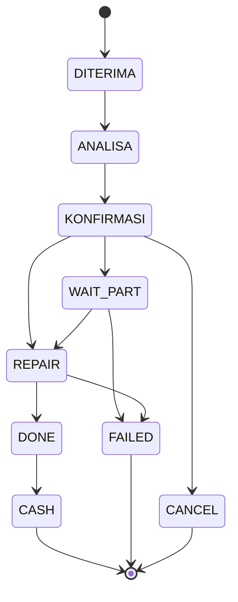

# SERVICE LIFECYCLE - BOSS SF

[`backend/statusflow.py`](../backend/statusflow.py) adalah satu-satunya sumber
`kewajiban()` dan `payment_summary()`.

Status servis disimpan di `service_orders.status`. Status **bayar** bersifat
diturunkan, tidak disimpan.

Aturan kanonik: [OD-LOCK-03](OWNER_DECISIONS.md),
[OD-LOCK-11.3](OWNER_DECISIONS.md).

---

## 1. Tiga dimensi status

Sering tercampur - memang sengaja dipisah.

| Dimensi | Sumber | Nilai |
|---|---|---|
| **Status Servis** | Kolom `service_orders.status` | 9 status (lihat bagian 2) |
| **Status Bayar** | **Diturunkan**, tidak disimpan | `LUNAS` / `BELUM LUNAS` |
| **Status Unit** | `unit_status` + `taken_at` | `DI TOKO` / `DIAMBIL` |

[FAKTA] `payment_status` tidak pernah di-update di database. Selalu dihitung
ulang oleh `payment_summary()` dari ledger `payments`.

---

## 2. Status kanonik (9)

`DITERIMA`, `ANALISA`, `KONFIRMASI`, `WAIT PART`, `REPAIR`, `DONE`, `CASH`,
`CANCEL`, `FAILED`.

| Status | Terminal | Arti |
|---|---|---|
| `CASH` | Ya | Selesai **dan** dibayar. Serah-terima otomatis. |
| `FAILED` | Ya | Gagal. Ada jalur refund failed-cancel. |
| `CANCEL` | Ya | Dibatalkan. |

---

## 3. Matriks transisi



### Tapi matriks itu bukan gerbang keras

[FAKTA] `check_transition()` menegakkan aturan berikut:

1. Target harus anggota `SERVICE_STATUSES`.
2. **Dari `CASH` diblokir mutlak** - bahkan dengan catatan. Ini yang menegakkan
   [OD-LOCK-03](OWNER_DECISIONS.md).
3. Dari status terminal (`CASH`/`FAILED`/`CANCEL`) butuh `catatan`.
4. Transisi di luar matriks **boleh** asal ada `catatan`.

Konsekuensi faktis: `DONE` ke `CANCEL`, `FAILED` ke `CASH`, dan
`DITERIMA` ke `CASH` semuanya lolos bila disertai `status_note`.

[FAKTA] `POST /api/orders` **tidak** memanggil `check_transition()`, berbeda
dengan `POST /api/orders/receive` yang memvalidasinya. Order bisa lahir dengan
status sah apa pun tanpa melalui matriks.

---

## 4. Terima unit

`POST /api/orders/receive` - otoritas `ORDER_CREATE` (SUPER/ADMIN/KASIR).

Empat jalur awal:

| Path | Status akhir | Chain yang di-log |
|---|---|---|
| `TITIP` | `DITERIMA` | DITERIMA |
| `PERBAIKAN` | `REPAIR` | DITERIMA - ANALISA - KONFIRMASI - REPAIR |
| `SPAREPART` | `WAIT PART` | DITERIMA - ANALISA - KONFIRMASI - WAIT PART |
| `TUNGGU` | `DONE` | DITERIMA - ANALISA - KONFIRMASI - REPAIR - DONE |

Syarat per path:

- `PERBAIKAN`/`SPAREPART` wajib **repair plan + estimasi > 0 + teknisi**.
- `TUNGGU` wajib plan + teknisi + `final_price` terdefinisi (boleh 0).

Seluruh chain di-log ke `status_history`.

### Modal di jalur TITIP

`final_price` hanya boleh diisi role ber-otoritas `ORDER_UPDATE_FINANCE`.

---

## 5. Kelayakan tiap status saat update

| Status | Syarat tambahan |
|---|---|
| `KONFIRMASI` | plan + estimasi |
| `REPAIR` | teknisi **aktif** |
| `DONE` | plan + teknisi + `final_price > 0`; modal `NULL` dinormalkan 0 |
| `CASH` | plan + `part_cost`/`modal_jasa` tidak `NULL` (boleh 0) |
| `FAILED` / `CANCEL` | wajib catatan |

[FAKTA] Pengecekan teknisi aktif **hanya** dipanggil saat status masuk
`REPAIR`. Jalur `receive`, `POST /api/orders`, dan `receive_claim` tidak
memanggilnya. Lihat [AUDIT_FINDINGS.md](AUDIT_FINDINGS.md).

---

## 6. Event CASH

Status `CASH` memicu rangkaian dalam satu operasi:

1. `unit_status` dipaksa `DIAMBIL`, `taken_at` = sekarang.
2. Pelunasan otomatis sebesar sisa dicatat (`method="CASH"`).
3. Modal keluar, dicatat per komponen ke ledger kas.
4. `lunas_at` dikunci.
5. Sisa Beban periode dicoba dibayar.
6. Notifikasi outbox `KAS_MASUK`.

Kalau `sisa == 0`, tidak ada baris payment baru - hanya jurnal.

[FAKTA] `cash_moment()` memakai `taken_at` lebih dulu, lalu `lunas_at`, lalu
`lunas_date`, lalu `service_date`, lalu `created_at`.

---

## 7. Handover

`POST /api/orders/{id}/handover` - otoritas `ORDER_HANDOVER`
(SUPER/ADMIN/KASIR/TEKNISI).

[FAKTA] Hanya untuk status `CASH`, `FAILED`, `CANCEL`. **`DONE` ditolak.**

Endpoint bersifat idempoten.

[FAKTA] Docstring di kode menyebut `DONE` termasuk yang diterima - itu
**stale**. Kode dan test yang benar.

---

## 8. Hapus order

`DELETE /api/orders/{id}` - otoritas `ORDER_DELETE` (SUPER/ADMIN).

Ditolak bila: ada payment, ada klaim, atau status sudah `DONE`/`CASH`/
`FAILED`/`CANCEL`.

---

## 9. Arsip

[FAKTA] Order berstatus `CASH` atau `CANCEL` disembunyikan dari daftar utama
bila momennya berada di periode yang sudah `CLOSED`. `FAILED` **tidak**
diarsipkan.

---

## 10. Garansi

### Syarat bisa membuat klaim

Unit asal harus:
- `LUNAS` (dari ledger), **dan**
- `warranty_months != 0`

Kalau tidak, **409**.

[FAKTA] Klaim = record **baru** bernomor `CLM-...`. Order servis lama tidak
diubah.

### Mulai masa garansi

`taken_at`, dengan fallback `lunas_date`, lalu `service_date`.

Panjang = `warranty_months` (nilai sah: 0, 1, 3, 6). Default 1 bila `DONE`
tanpa input.

### Klaim dalam daftar

Hanya unit `CASH` + `LUNAS` + `warranty_months != 0` **yang periodenya sudah
`CLOSED`**.

### Resolusi

`REPAIR`, `REPLACE`, `REFUND`.

[FAKTA] Resolusi **tidak** mengirim uang. `REFUND` hanya mencatat field;
pengeluaran uang tetap dilakukan manual. `DITOLAK` wajib `reject_reason`.

### Ubah / hapus klaim

`PUT`/`DELETE` butuh `CLAIM_WRITE` (SUPER/ADMIN). `DELETE` ditolak bila status
`SELESAI`/`DITUTUP`.

---

## 11. Refund

Tiga jenis, dana dan otoritas **terpisah**.

| Jenis | Endpoint | Otoritas | Sumber dana | Otomatis? |
|---|---|---|---|---|
| DP | `POST /api/refunds/dp` | SUPER/ADMIN/KASIR | Laci | Ya |
| Garansi | `POST /api/refunds/garansi` | SUPER/ADMIN | Kas Aset | **Tidak** |
| Failed-cancel | `POST /api/refunds/failed-cancel` | SUPER/ADMIN/KASIR | Laci | Ya |

[TERKUNCI] Refund garansi **manual** ([OD-LOCK-05](OWNER_DECISIONS.md)) -
dicatat lewat `POST /api/kas/aset/keluar`.

### Plafond

| Jenis | Batas |
|---|---|
| DP | <= DP diterima, <= sisa belum direfund |
| Garansi | default `claim.customer_cost` + pre-check saldo Aset |
| Failed-cancel | <= total diterima |

[FAKTA] Refund **tidak menulis reversal ke `payments`**. Unit yang sudah LUNAS
tetap LUNAS.

---

## 12. Mapping status legacy

[FAKTA] Dipetakan satu kali saat migrasi startup (`main.py`,
`LEGACY_STATUS_MAP`):

| Legacy | Kanonik |
|---|---|
| `RECEIVED` | `DITERIMA` |
| `DIAGNOSIS`, `DIAGNOSA` | `ANALISA` |
| `WAITING_APPROVAL` | `KONFIRMASI` |
| `WAITING_PART` | `WAIT PART` |
| `PERBAIKAN`, `QC` | `REPAIR` |
| `READY`, `SELESAI`, `COMPLETED` | `DONE` |
| `GAGAL`, `FILED` | `FAILED` |
| `BATAL`, `CANCELLED` | `CANCEL` |

Mapping ini **eksplisit**, tidak ada replace global.

---

## 13. Verify sendiri

```powershell
python -m pytest tests\test_od_lock.py tests\test_garansi_detail.py `
  tests\test_garansi_*.py tests\test_dp_kelebihan_bayar.py `
  tests\test_frontend_fail_closed.py -q
```
