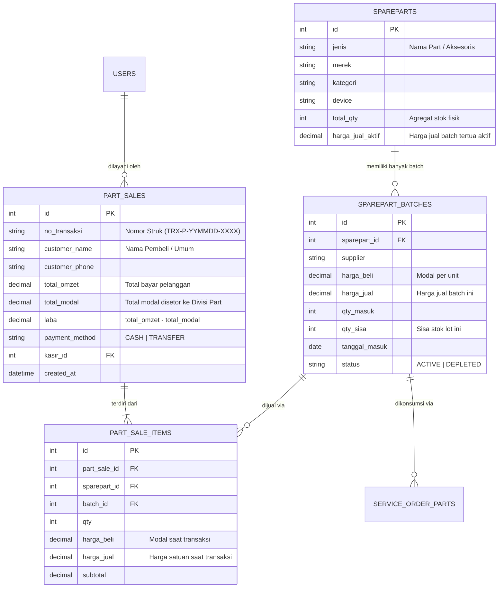
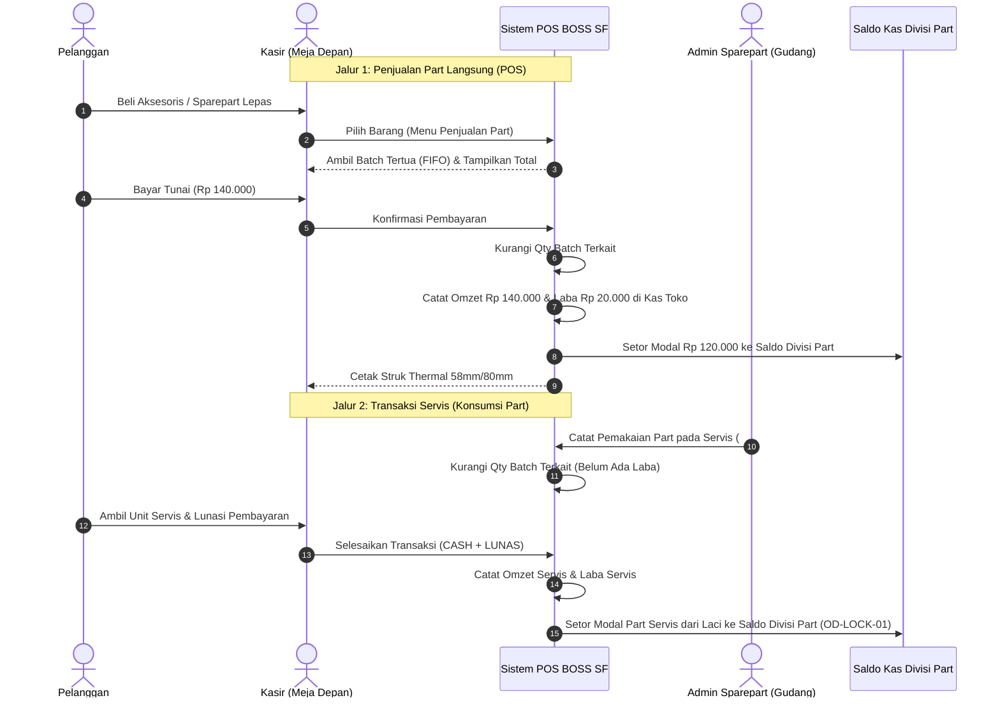

# SPESIFIKASI_SPAREPART_DAN_PENJUALAN.md — Spesifikasi Fitur Sparepart & Penjualan Langsung BOSS SF

Dokumen ini adalah **spesifikasi kanonik** hasil kesepakatan diskusi bersama Owner mengenai pengembangan fitur Inventaris Sparepart, Penjualan Part Langsung (POS Kasir), dan integrasi alur keuangannya ke dalam sistem BOSS SF.

---

## 1. LATAR BELAKANG & TUJUAN BISNIS

Sistem BOSS SF membutuhkan pengelolaan sparepart yang mencakup dua fungsi operasional:
1. **Pengadaan & Pengelolaan Stok Fisik (Divisi Sparepart)**:
   - Mengelola stok barang, melacak riwayat pengadaan dari berbagai supplier dengan variasi harga modal, dan mencegah kehabisan stok (*stockout*).
2. **Dua Jalur Penjualan / Pengeluaran Barang**:
   - **Jalur 1 (Penjualan Part Langsung / Eceran)**: Melayani pelanggan yang membeli aksesoris/sparepart langsung di meja kasir tanpa jasa servis (menghasilkan omzet dan laba seketika).
   - **Jalur 2 (Konsumsi Servisan)**: Dipasang ke perangkat servis pelanggan (laba diakui saat unit selesai dan dilunasi oleh pelanggan).
3. **Kemandirian Dana Perputaran (*Revolving Fund*) Divisi Sparepart**:
   - Memisahkan dana belanja pengadaan sparepart dari kas harian toko.
   - Mengembalikan modal barang secara otomatis ke Divisi Sparepart setiap kali part terjual atau servisan lunas (menegakkan aturan baku `OD-LOCK-01`).

---

## 2. ATURAN BISNIS KANONIK (BUSINESS RULES)

### BR-SP-01: Manajemen Stok FIFO Berbasis Batch (Lot Pengadaan)
1. Setiap pengadaan barang masuk dari supplier dicatat sebagai **Batch Lot** tersendiri (memuat: supplier, modal beli, saran/ketetapan harga jual, qty masuk, dan qty sisa).
2. Sistem menerapkan prinsip **FIFO (First In, First Out)** secara ketat:
   - Stok dari batch terlama diprioritaskan untuk dijual/dipakai terlebih dahulu dengan harga jual batch lama.
   - Setelah stok batch lama habis (`qty_sisa = 0`), sistem otomatis beralih menggunakan batch berikutnya dengan harga jual baru yang disesuaikan kenaikan modalnya.
3. Penetapan harga jual baru saat barang masuk didukung fitur **Saran Margin Otomatis** (misal markup persentase dari modal), namun Admin Sparepart tetap dapat mengubah angkanya secara manual sesuai harga pasar.

### BR-SP-02: Dua Jalur Pengakuan Laba (Dual-Channel Realization)
1. **Jalur Penjualan Langsung**:
   - Transaksi terjadi seketika di kasir.
   - Nilai transaksi diakui sebagai **Omzet Penjualan Part**.
   - Modal part dikeluarkan dari transaksi tersebut untuk disetor ke Kas Divisi Sparepart.
   - Selisih `Harga Jual − Modal Part` langsung menjadi **Laba Penjualan Part** toko.
2. **Jalur Konsumsi Servis**:
   - Saat part diambil dan dipasang pada unit servis (`PROSES`), stok fisik berkurang dan tercatat di `service_order_parts`.
   - **Belum ada pengakuan omzet maupun laba** pada momen pemasangan part.
   - Omzet dan laba baru diakui secara resmi ketika unit servis berstatus `CASH` + `LUNAS` + `DIAMBIL`.

### BR-SP-03: Penyelarasan Aturan Terkunci OD-LOCK-01 & Perputaran Kas Divisi Part
1. Aturan `OD-LOCK-01` di `docs/OWNER_DECISIONS.md` menyatakan:
   > *"Modal Part dan Modal Jasa langsung dikeluarkan dari Laci ketika transaksi menjadi CASH."*
2. Selaras dengan aturan tersebut:
   - `Modal Part` yang dikeluarkan dari kasir laci saat servis lunas **disetorkan ke Saldo Kas Divisi Sparepart**.
   - `Modal Part` dari transaksi penjualan langsung juga **disetorkan ke Saldo Kas Divisi Sparepart**.
3. Saldo Kas Divisi Sparepart menjadi dana perputaran mandiri (*revolving fund*) yang digunakan oleh Admin Sparepart untuk belanja stok baru ke supplier tanpa mengganggu kas laci operasional harian.

### BR-SP-04: Penyelarasan Laporan Kondisi Kas Operasional
1. Di tabel **Kondisi Kas Operasional**, baris Omzet diselaraskan menjadi:
   - **"Total Penjualan Part & Service"** (Omzet Servis + Omzet Penjualan Part Langsung).
2. Baris Modal mencakup:
   - **"Total Modal (Part+Jasa+Lain)"** (Modal Part Servis + Modal Jasa + Modal Part Penjualan Langsung yang disetor ke Divisi Part).
3. Saldo Laba Toko di kasir tetap mencerminkan:
   $$\text{Laba Kotor} = \text{Total Penjualan (Part \& Service)} - \text{Total Modal}$$

---

## 3. ARSITEKTUR DATA (DATABASE SCHEMA)



---

## 4. ALUR OPERASIONAL & PERPUTARAN KAS



---

## 5. RANCANGAN ANTARMUKA PENGGUNA (UI/UX)

### 5.1 Menu Sidebar Navigasi (Opsi 1 Terpilih)
Menu baru ditambahkan di sidebar navigasi utama, tepat di bawah **Servis Baru**:

```
[Icon] Dashboard
[Icon] Servis Baru          (Admisi unit HP diservis)
[Icon] Penjualan Part       (Kasir POS penjualan part/aksesoris langsung)  <-- MENU BARU
[Icon] Transaksi            (Daftar kerja & riwayat servisan)
[Icon] Pelanggan
[Icon] Garansi
[Icon] Sparepart            (Katalog gudang & stok batch)
[Icon] Keuangan             (Arus kas operasional & tutup kas)
```

### 5.2 Halaman Kasir POS Penjualan Part (`#pagePenjualanPart`)
1. **Panel Kiri / Atas (Katalog & Pencarian Cepat)**:
   - Pencarian instan (nama part, tipe HP, merek, atau barcode/SKU).
   - Menampilkan stok tersedia, harga jual aktif (FIFO), dan indikator batch.
   - Klik item untuk menambahkannya ke keranjang kasir.
2. **Panel Kanan (Keranjang & Pembayaran)**:
   - Daftar item belanja (qty bisa diubah, tombol hapus item).
   - Ringkasan subtotal, diskon (jika ada), dan total bayar.
   - Input nama/nomor HP pembeli (opsional, default: "Pelanggan Umum").
   - Pilihan metode bayar: **Tunai (Cash)** atau **Transfer**.
   - Input nominal uang diterima & hitungan kembalian otomatis.
   - Tombol utama: **"Proses & Cetak Struk"**.

### 5.3 Struk Thermal Penjualan Part (58mm / 80mm)
Format cetak thermal standar kasir yang ringkas dan hemat kertas:
- Header: Nama Toko (SUKABUMI TECH FLASHER / BOSS SF), Alamat, No. Telp/WA.
- Info Transaksi: No. Struk (`#TRX-P-xxxx`), Tanggal, Jam, Nama Kasir.
- Tabel Item: Nama barang, Qty × Harga Satuan, Subtotal.
- Total Bayar, Uang Diterima, Kembalian, Metode Bayar.
- Footer: *"Barang yang sudah dibeli dapat ditukar maksimal 2 hari dengan membawa struk ini. Terima kasih atas kunjungan Anda."*

### 5.4 Notifikasi Pengingat Restock (Aspek B Terpilih)
- Di popover lonceng notifikasi header (`#headerNotifPop`):
  - Kartu peringatan jika ada sparepart yang stoknya **Habis (0)** atau **Menipis (≤ batas minimum)**.
  - Ditujukan ke **Admin** dan **Admin Sparepart**.
  - Tombol aksi langsung: `Pengadaan Restock ->` membuka form tambah batch di menu Sparepart.

---

## 6. RENCANA IMPLEMENTASI BERTAHAP

1. **Fase 1: Fondasi Data & Backend Engine**:
   - Model `SparepartBatch` untuk pelacakan batch FIFO.
   - Model `PartSale` dan `PartSaleItem` untuk pencatatan penjualan langsung.
   - Endpoint pengadaan batch masuk (`POST /api/spareparts/{id}/batches`).
   - Endpoint transaksi penjualan langsung (`POST /api/spareparts/sales`).
   - Endpoint daftar riwayat penjualan part (`GET /api/spareparts/sales`).
   - Integrasi penghitungan omzet dan modal penjualan part ke dalam `backend/finance.py`.
2. **Fase 2: Frontend Kasir POS & Struk Thermal**:
   - Tambah menu sidebar `Penjualan Part` di [frontend/index.html](file:///d:/PRAKTEK%20MJPRO/frontend/index.html).
   - Implementasi halaman kasir POS penjualan di [frontend/script.js](file:///d:/PRAKTEK%20MJPRO/frontend/script.js).
   - Modal cetak struk thermal 58mm/80mm siap print browser (`window.print()`).
3. **Fase 3: Integrasi Pengingat Restock & Kondisi Kas**:
   - Menghubungkan peringatan stok menipis/habis ke popover lonceng notifikasi header.
   - Memperbarui baris Kondisi Kas Operasional menjadi *"Total Penjualan Part & Service"*.
4. **Fase 4: Verifikasi & Pengujian Komprehensif**:
   - Menulis unit test backend dan integration test (memastikan perhitungan FIFO dan rekonsiliasi kas 100% akurat).
   - Memastikan seluruh test suite (`pytest`) tetap hijau tanpa regresi.

---

*Dokumen ini disusun pada 28 Oktober 2026 berdasarkan persetujuan final Owner BOSS SF.*
